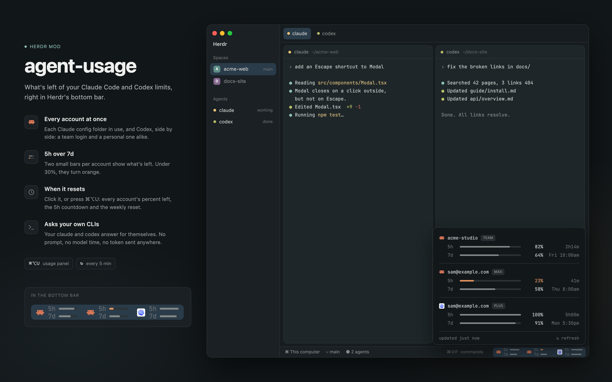

# agent-usage

What's left of your Claude Code and Codex limits, in Herdr's bottom bar. Every Claude
account you use (one per `CLAUDE_CONFIG_DIR`) and Codex, side by side: per account its logo
and two small bars, the 5-hour window over the 7-day one. Click it, or press `⌘⌥U`, for every
account at once: what's left of each window and when it resets.

Bars and numbers show what's **left**. Under 30% left, they turn orange.



## Install

Copy `mods/agent-usage/` into `~/.config/herdr-app/mods/`. With the [naps](../naps/) layout, add
the `agent-usage` block below to its `status-row`, between `status` and `naps`. Otherwise, in a
layout of yours (a clone of `main`: `herdr-app do layout.clone '{"name":"main","as":"my-main"}'`),
replace the `status` block with this row:

```json
{ "id": "status-row", "type": "row", "size": { "px": 28 }, "resizable": false, "children": [
  { "id": "status", "type": "block", "size": { "weight": 1 }, "content": { "mod": "workspace-status" } },
  { "id": "agent-usage", "type": "block", "size": { "px": 160 }, "content": { "mod": "agent-usage" } } ] }
```

And add the key to `~/.config/herdr-app/keys.json`:

```json
"global": { "cmd-alt-u": "agent-usage.toggle" }
```

## Which accounts

- Your default Claude account (`~/.claude.json`).
- Every other Claude config folder a running `claude` uses (`CLAUDE_CONFIG_DIR`, read from
  `ps`). Once seen, a folder stays listed after its sessions close. The same login in two
  folders is one account.
- Codex, when it's signed in.

Names: a Team or Enterprise account shows its organization, a Pro or Max account its email,
Codex its ChatGPT email.

## What it runs

Every 5 minutes, when the panel opens, and on ↻:

- `ps`, to find the Claude config folders in use (macOS).
- Your `claude` CLI, briefly, once per account, with `--safe-mode`, sending it the
  `get_usage` control request (`helpers/claude-usage.sh`). It sends no prompt and uses no
  model time. `get_usage` is an internal Claude Code interface (checked 2026-11-13); if an
  update changes it, that account shows its last reading dimmed with an error line.
- `codex app-server`, briefly, asking `account/rateLimits/read` (`helpers/codex-limits.sh`).

Labels come from each `.claude.json` (organization, email, plan) and from Codex's
`~/.codex/auth.json`: that file holds Codex's sign-in tokens, and the mod decodes only the email
and plan in its ID token. It never sends a token anywhere, never reads Claude's credentials (the
CLI signs itself in), and changes no Claude or Codex setting.

## Credits

The `get_usage` approach comes from
[jmalicki/herdr-mod-ai-usage](https://github.com/jmalicki/herdr-mod-ai-usage) (MIT), via
[nozikov/herdr-usage-limits](https://github.com/nozikov/herdr-usage-limits) (MIT). The Claude
and Codex marks are from [LobeHub Icons](https://github.com/lobehub/lobe-icons) (MIT,
`@lobehub/icons-static-svg` 1.102.0: `claude-color`, `codex-color` without its tile).

[RECIPE.md](RECIPE.md) is the brief to build it again.
