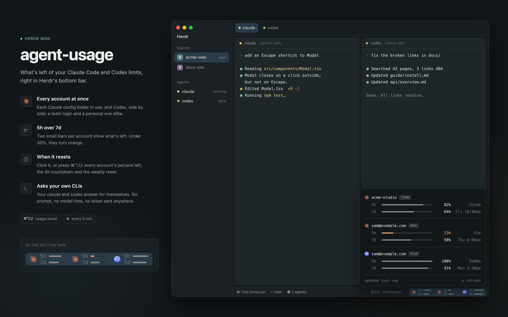

# agent-usage

What's left of each Claude Code account's and Codex's 5-hour and 7-day limits: one button in
the bottom status row, one panel. This is the brief; the files beside it are one build.

## What you see

### The button (`mods/agent-usage`, default mode)

- A block beside `workspace-status` in the 28px status row, `chrome` background, a 1px
  `border` line on top like the status beside it. The block sizes itself to the button
  (`layout.resize` to the button's width plus 8px a side), so `workspace-status` keeps the rest
  of the row. One button for everything: 24px high, 8px side padding, 6px corners,
  `hover` on hover, `selected` while the panel is open. Tooltip "Agent usage (⌘⌥U)".
- Per account, 14px apart, all alike: the logo (13px; each provider's mark in its own colours), then two lines, `5h` over `7d` (10px terminal font, `dim`, 11px line
  height), each with a 30×3px bar on a `border` track.
- Bars show what's left. Fill `muted`; `ansi3` under 30% left.
- No reading yet: the logo at 40%. A failed reading with an older one: bars at 50%.

### The panel (`props: { mode: "panel" }`)

- A popup, 400px wide, as tall as its accounts (a popup can't grow): `popover` background,
  1px `border`, 12px corners, 12px terminal font (Herdr's `font` setting, Menlo when unset), no frame from Herdr.
- Per account, 10px padding, a `border` line under each: logo (14px), label (cut in the
  middle past 26 characters), plan badge (`raised` background, 9.5px semibold capitals,
  all `muted`: the words tell plans apart, colour is kept for a low limit). Then `5h` and `7d` rows, 22px
  each, indented 22px: label (`dim`) · 160×4px bar · % left (`foreground`, `ansi3` when low,
  `—` unknown) · reset (`dim`; 5h a countdown `1h54m`, 7d a day and time `Sun 8:00am`).
- A failed account: one 11px `dim` line under it, the error and the age of what it shows
  (`No reply · last read 2 d ago`), its rows at 60%.
- Unknown (no reading, reset passed): in the button a faint track with no fill, in the panel `—`.
- Height: a popup is drawn as tall as its content, and it is placed by the height it is given:
  so that height is the content's exactly (`panelHeight`), an error line only under a failed
  account. If the poll it starts finds another account or a new error, the button opens it
  again at the new height.
- A click on the button that closes the panel doesn't open it again (a toggle within 400 ms
  of a close is ignored).
- Footer, 34px: `updated just now` / `updated N min ago` left, `↻ refresh` right.
- Esc or a click outside closes it; so does the button or `⌘⌥U` again. It opens above the
  button, right edges lined up, 6px apart. A mod learns where its block is only from a pointer
  event, so the button's place is kept (shared `agent-usage:place`) as its distance from the window's
  bottom-right corner, which holds when the window is resized and after a restart; before the
  pointer has ever crossed it, it is taken to be the right end of a 28px status row.

## Where the numbers come from

- Claude: `helpers/claude-usage.sh` runs `claude -p --safe-mode --no-session-persistence
  --input-format stream-json --output-format stream-json --verbose` with one
  `control_request` `get_usage` line as input, prints the `control_response` line, kills the
  CLI. `session` → 5h, `weekly_all` → 7d; per-model limits are ignored. The default account
  runs with `CLAUDE_CONFIG_DIR` unset (set to `~/.claude` it isn't signed in), others with it.
- Codex: `helpers/codex-limits.sh` asks `codex app-server` for `account/rateLimits/read`;
  windows by length (300 and 10080 minutes).
- Accounts: `~/.claude.json`, plus each `CLAUDE_CONFIG_DIR` seen in `ps -axwwE -o command=`
  (remembered), plus Codex's `~/.codex/auth.json`. One per `accountUuid`.
- Labels: a name set in shared `agent-usage:names` (`{ id: name }`) wins; Team/Enterprise the
  organization, else the email; never "…'s Organization".
- Readings, folders and the open panel's id live in shared state (`agent-usage:*`): the button and
  the panel are separate copies, and each copy has its own `localStorage`.
- The button asks on start and every 5 minutes; the panel on open and on ↻. A failed ask
  keeps the last good limits and shows the error. A window past its reset shows `—`.

## Files

- `lib/` (pure, `node --test`): `format.js`, `claude.js`, `codex.js`, `accounts.js`,
  `plan.js`, `layout.js`, `name.js`. Tests in `agent-usage/tests/`, fake CLIs in `agent-usage/tests/fake/`.
- `host/`: `poll.js` (find and ask), `bar.js`, `panel.js`, `look.js` (logo, bar, badge).
- `helpers/`: the two POSIX scripts. `icons/`: the two marks, from LobeHub Icons (MIT; see README).
