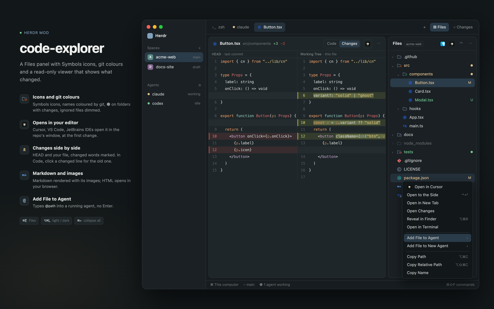

# code-explorer

A Files panel for the [Herdr](https://herdr.dev) desktop app: Symbols icons, git colours, menus
that open a file in your editor or hand it to an agent, and a read-only viewer that shows what
changed.

> [!IMPORTANT]
> A mod for the **Herdr desktop app** (the native window), built and tested on macOS. It takes
> the place of the Files panel; it doesn't run in `herdr`, the terminal app.



- **Icons and git colours.** [Symbols](https://github.com/miguelsolorio/vscode-symbols) icons in full
  colour, names coloured by git (`U` `A` `M` `D` `!`), a ● on folders that hold changes, ignored
  files dimmed, `.DS_Store` and friends hidden. It keeps itself current as you work: no Refresh.
- **Opens in your editor.** Finds the editors you have (Cursor, VS Code, Antigravity, Windsurf,
  JetBrains IDEs, Zed, Sublime Text…). VS Code-family editors and JetBrains IDEs open a file in the
  window of its repo, at the first change; the others open the file. One click from the header,
  the viewer or right-click; open with another once and it becomes the default. HTML opens in your
  browser the same way.
- **Shows what changed.** Code in your theme's colours with change bars; click one to see the
  lines it replaced. **Changes** puts HEAD and your file side by side with the changed words
  marked, and folds into one column when the pane is narrow. The header counts `+38 −1`.
- **Markdown and images.** Markdown rendered with its local images, images to fit or at 100%.
  Every view follows the file as it changes. (HTML: open it in your browser; here it's text only.)
- **Hands files to agents.** Right-click › Add File to Agent types `@path ` into a running agent
  without pressing Enter; Add File to New Agent starts one in the repo first.
- **Keys.** ⌘E for the panel, ⌥⌘L for light and dark, ⌘← to collapse everything.

## Install

Ask your agent in Herdr:

```text
Read ~/.config/herdr-app/AGENTS.md, then add this mod: https://github.com/kimmojae/herdr-mods/tree/main/code-explorer
```

It copies the mod, merges its keys into your `keys.json` and points your layout's Files panel at
it ([RECIPE.md](RECIPE.md) has the steps). It works with any layout and theme; the
[naps](../naps/) layout is the one it's drawn in here (add that first).

## Uninstall

```text
Read ~/.config/herdr-app/AGENTS.md, then remove the code-explorer mod
```

By hand, in `~/.config/herdr-app`: point your layout's Files block back at `files`, delete
`mods/code-explorer/`, and take its keys out of `keys.json` (the `mod:code-explorer` section and
`cmd-e`, `cmd-alt-l` under `global`).

## Use

| | |
|---|---|
| **Click** a file | preview it (one tab, reused; ⋯ › Click Opens can pin instead) |
| **Double-click** | keep it open |
| **⌘-click** | open it to the side |
| **⌥-click** a folder | open everything inside |
| **Right-click** | Open in your editor or browser, Open to the Side, Open Changes, Reveal in Finder, Open in Terminal, Add to Agent, Copy Path |

| Key | Where | |
|---|---|---|
| ⌘E | anywhere | open or close the Files panel |
| ⌥⌘L | anywhere | light ↔ dark (also ⋯ › Light Mode) |
| ⌘← | Files | collapse all |
| ↑ ↓ ← → · Enter · Space | Files | move, open and close folders · open pinned · preview |
| ⌥⌘C · ⌥⇧⌘C | Files | copy path · copy relative path |
| ⌥⌘R · ⌃↩ | Files | reveal in Finder · open to the side |

## Needs

The Herdr desktop app and `git`. Opening files in other apps, the Finder button and image previews
use macOS tools; elsewhere the tree, the viewer and the agent menus should still work, but this is
only tested on macOS.

**What it runs:** `git` (status, ignored files, diffs; read-only, no locks), `sh`, `osascript`
(which editors and browsers you have), `sips` (app icons, image sizes), `stat`, `open`, and your
editor's own command-line tool (`cursor`, `code`, `idea`…). No network.
**What it writes:** its hidden `.cache/` (image copies, app icons, cleaned as tabs close), and
`appearance` in Herdr's `settings.json` when you switch light and dark.

## Limits

500 entries a folder and 5,000 rows; files over 1 MB or 400,000 characters are cut or not shown;
images over 20 MB aren't previewed. HTML shows without CSS or scripts: open it in your browser
for the page. Markdown follows the Herdr theme's colours (switch to light to read on white).

## Credits

Started from Herdr's own `files` mod (Apache-2.0). Icons are generated from
[Symbols](https://github.com/miguelsolorio/vscode-symbols) by Miguel Solorio (MIT). See
[NOTICE](../NOTICE).
