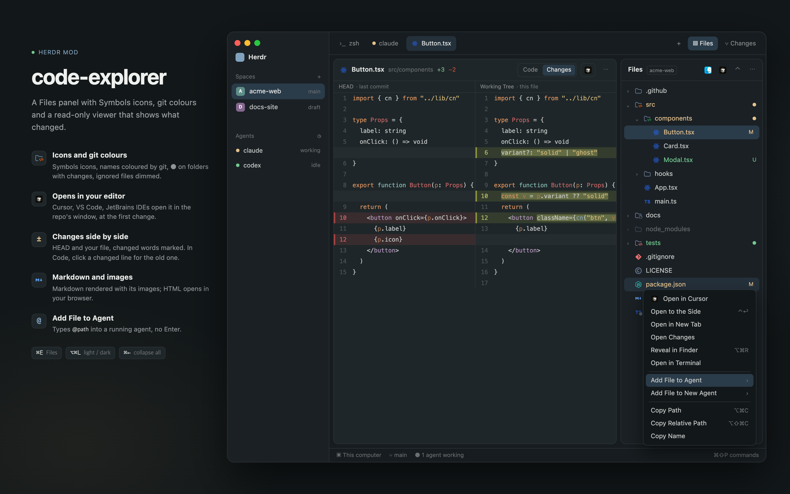

# code-explorer

A Files panel that works like Cursor's explorer: the focused terminal's folder as a tree with
Symbols file icons, git letters and ignored files dimmed; right-click menus that open at the
pointer; and a read-only viewer in tabs or splits with theme-coloured code, changed lines,
Markdown, images and HTML. 

## What you see

- **Panel** (the layout's Files block): `chrome` background, radius 10, 1px `border`. Header 42px:
  "Files", the folder name in a 10px bordered badge, then 24px buttons (Finder's icon: open the
  folder in Finder; the default editor's icon: open the repo there; both this Mac only,
  collapse, ⋯). No Refresh: the folder watch (recursive on macOS) updates at once,
  a 10-second timer covers another machine's folders.
- **Rows** 28px, indent 8 + 18 per level: chevron 12px (`dim`), Symbols icon 16px in full colour,
  name, git letter 11px as Cursor shows them (U untracked, A added, M, D, ! conflict); a folder
  holding changes gets a 9px ● in its strongest change's colour. Name and mark take the theme's
  `gitDecoration.*` colour (Cursor's defaults where the theme has none: U `#73c991`, A `#81b88b`,
  M `#e2c08d`, D `#c74e39`, ! `#e4676b`; generated into `syntax/*.json`). Ignored rows at 42% opacity. The
  selected / active file row has `selected` background.
- **Menu**: a 236px popup with its top-left at the pointer, `popover` background, 28px rows, 9px
  separators, shortcuts in `dim`. A submenu replaces the menu in place under a "‹ name" back row;
  The editor list (default "✓ default") and, for .html/.htm, the browser list (macOS's default
  "macOS default") each stand alone, with real icons; no combined Open With, no other apps (Obsidian,
  Preview…) or Finder-style Other… until someone needs them. No hint lines in menus.
- **Viewer** tab: a 36px header (file icon, name, folder · Preview, "+added −removed" lines in the git A and D colours,
  then Keep Open, Preview/Code/Changes, Fit/100%, the default editor's icon button and, for HTML,
  the default browser's (tooltips "Open in <app>"; a ▾ part only with more than one to choose), ⋯).
  The Files header has Finder's and the default editor's icons. Code rows are
  `round(font_size × 1.6)` high with a 3px change bar and a 15% tint: added `ansi2`, changed
  `ansi3`, removed a 2px `ansi1` line; old lines in `ansi1`. Clicking a changed line opens that
  one change's old lines (Cursor's gutter click); there is no Expand all: that is Changes.
- **Changes** (like Cursor's Open Changes): HEAD left, the file right, one row per pair, split by
  a 1px `border`. Left tinted `ansi1`, right `ansi2`; the differing middle of a changed line at 35%;
  a line on one side faces a gap (`foreground` at 4%). Under 900px wide (Cursor's breakpoint) it
  is inline instead: the code view with every change open, "Inline · narrow" in the header. Only
  for files with a HEAD to compare.

## How it behaves

- Folder: the focused pane's cwd; with a viewer focused, the folder its file came from.
- Never listed, like Cursor's default `files.exclude`: `.git .svn .hg CVS .DS_Store Thumbs.db`.
  Other dotfiles show; ⋯ › Hide Dotfiles hides them all.
- Click a file: `clickOpens` (preview tab or pinned tab; older saved values preview); double-click keeps the preview
  tab; ⌘-click opens to the side; ⌥-click a folder opens everything inside (≤ 2,000 entries).
- Menu ids and order: open-in-editor, editor-list (2+ editors), open-in-browser, browser-list (HTML;
  2+ browsers) — all local only —, open-side, open-tab, open-changes (an `M` file), reveal, terminal | add-agent, add-new-agent |
  copy-path, copy-rel, copy-name. Folders have no Expand/Collapse (a click does that, ⌘← collapses
  all, as in Cursor); the empty area is the root folder's menu; another machine hides the app items and Reveal.
- Header ⋯: Click Opens, Hide Dotfiles, Hide Ignored Files, Follow Active File | Light Mode / Dark Mode. A viewer's ⋯ is the file menu without
  the app items (its header has them) and Open in New Tab. Installed apps
  are looked for at start and again when a menu opens over 5 minutes later.
- Editors: `apps.jxa editors` scans /Applications, ~/Applications and JetBrains Toolbox's folder:
  VS Code forks by `Contents/Resources/app/product.json` + `bin/<applicationName>`, JetBrains by
  bundle id `com.jetbrains.*` (not Toolbox, DataGrip or Gateway) or Android Studio, plus Zed,
  Sublime, Nova, BBEdit.
  Order: Cursor, VS Code, Insiders, Antigravity, Windsurf, Zed, then by name. The default is
  `shared("code-explorer:editor")` while installed, else the first; opening with an editor from
  Open in Other Editor (or the viewer's editor ▾) sets it; browsers never do.
- Opening runs one command (menus close first): VS Code forks `<cli> <repo> [--goto file:line]`,
  JetBrains `<launcher> <repo> [--line N] file`, the repo from `git rev-parse --show-toplevel`
  (else the file's folder); other apps `open -a`.
- Add File to Agent: clipboard `@rel `, `pane.focus`, `terminal.paste` (never Enter). New Agent:
  `tab.new {argv: agent.run}`, wait until idle (500ms, give up after 30s), then paste.
- Viewer: one preview tab per space, reused and renamed; registry in `shared("code-explorer:viewers")`;
  reloads on folder-watch events for its exact path (remote: every 5s); git marks every 5s.
- Tree keys (focused): ↑ ↓ move, → open / into, ← close / up, ⌘← collapse all (as in Cursor),
  Enter open pinned, Space preview.
- Keys under `mod:code-explorer` in keys.json: `cmd-alt-c`, `cmd-alt-shift-c`, `cmd-alt-r`, `ctrl-enter`.
  Global `cmd-alt-l` (and header ⋯ › Light Mode / Dark Mode): light ↔ dark, by writing `appearance` to
  settings.json (live; Herdr has no command for it); any copy on screen takes it, once per 0.5 s.
  Global `cmd-e`: `layout.toggle {id: "panel"}` opens and closes the right panel (Files, or Changes if
  that was last picked). Not a mod command: Herdr doesn't deliver key commands to a hidden copy,
  so the mod couldn't reopen its own panel.

## Built from

- `mods/code-explorer/main.js`: one View, roles by `props().mode`: sidebar, viewer, menu.
- `lib/` (pure, `node --test`): paths, status, ignore, icons, menu, openwith, registry, highlight,
  palette, hunks, markdown, cache, name (the mod's name, rewritten for a working copy). `host/`: tree, menu-view, viewer (+ viewer-header, viewer-views), actions, apps (+ `apps.jxa`),
  agents. `icons/`, `icons.json`, `syntax/*.json` are generated by `scripts/import-cursor.mjs`.
- Herdr: `spaces panes focused agents knownAgents exec readTextFile watchFolder openOverlay
  closeOverlay shared setShared nextCommand theme settings appHome`; commands `tab.new tab.select
  tab.rename pane.split pane.focus terminal.paste`.

## Watch out

- GPUI elements are single-use: build icons in render, never store them.
- All three roles share one class: method names must be unique across host files.
- Virtual-list rows can't take their own clicks: use `on_item_click`.
- `sips` takes no `--`. Herdr draws images only from under its own folder: copy into `.cache/` (hidden: writing elsewhere under mods/ reloads the mod and loops).

## Done when

- `herdr-app check` passes; the tree shows Symbols icons and dims `node_modules`.
- Right-click opens at the pointer; Open in <editor> opens the file in its repo's window.
- A click opens a preview tab that the next click reuses; double-click keeps it.
- A changed file shows coloured bars; clicking a changed line shows the old lines.
- A Markdown file renders; Code shows it highlighted.
