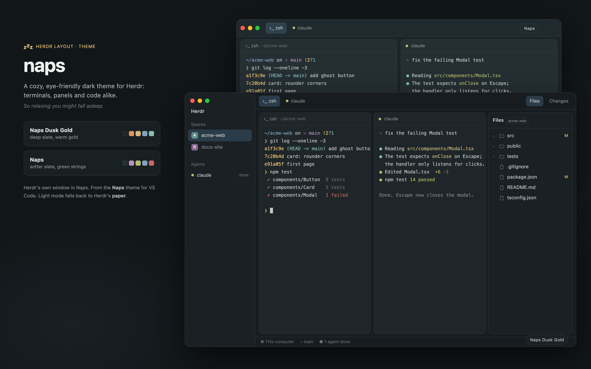

# naps

A cozy, eye-friendly dark theme for Herdr: the
[Naps theme](https://marketplace.visualstudio.com/items?itemName=kimmojae.naps-theme) for VS Code,
brought to terminals, panels and code alike. Two flavours, **Naps** and **Naps Dusk Gold**, in
Herdr's own window.



## Install

Ask your agent in Herdr:

```text
Read ~/.config/herdr-app/AGENTS.md, then add this layout: https://github.com/kimmojae/herdr-mods/tree/main/naps
```

Both themes then appear in Settings → Look. Naps is dark only for now: in light mode the layout
uses Herdr's `paper`. Switch with Settings → Appearance, or ⌥⌘L with code-explorer installed.

Want [code-explorer](../code-explorer/) too? Install it after this layout and it takes over the
Files panel.

## Uninstall

```text
Read ~/.config/herdr-app/AGENTS.md, then remove the naps layout and its themes
```

By hand: switch to another layout (⌃⇧L) and pick another theme in Settings → Look, then delete
`layouts/naps.json` and `themes/naps.json`, `themes/naps-dusk-gold.json` in `~/.config/herdr-app`.
