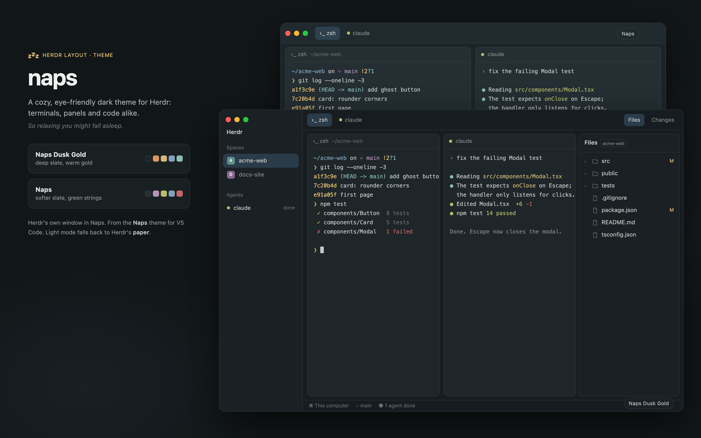

# Naps

Herdr's own window in the Naps themes: Naps Dusk Gold in dark mode, Herdr's `paper` in light
mode. 

## What you see

The shipped `main` layout unchanged except the root `"theme": {"light": "paper", "dark":
"naps-dusk-gold"}` (Naps has no light variant yet). Colours (Naps Dusk Gold): terminal background
`#1e2629`, sidebars `#1a2024`, canvas `#161c1f`, popovers `#12171a`, accent `#81a2be`, primary
button `#4b7293`.

## How it behaves

As Herdr's `main`. Both `naps` and `naps-dusk-gold` are listed in Settings → Look; the theme
picker overrides the layout's theme (a light theme sets the light half, a dark one the dark half),
and Settings → Appearance (System / Light / Dark) picks the half.

## Built from

- `layouts/naps.json`: a copy of the shipped `main.json` (Herdr 0.1.15) with the theme above.
- `themes/naps.json`, `themes/naps-dusk-gold.json`: generated by `scripts/import-cursor.mjs` from
  the Naps theme for VS Code (editor, sidebar, list and terminal colours; translucent ones
  flattened).

## Install

1. Copy `themes/*.json` to `~/.config/herdr-app/themes/` and `layouts/naps.json` to `layouts/`.
2. `herdr-app do layout.switch '{"name":"naps"}'`.
3. With [code-explorer](../code-explorer/) wanted too: install it after this; its recipe points
   this layout's Files block at it.

## Watch out

The layout is a copy, so Herdr updates to `main` don't reach it.

## Done when

`herdr-app status` shows layout `naps` with no errors; the terminal background is `#1e2629`.
