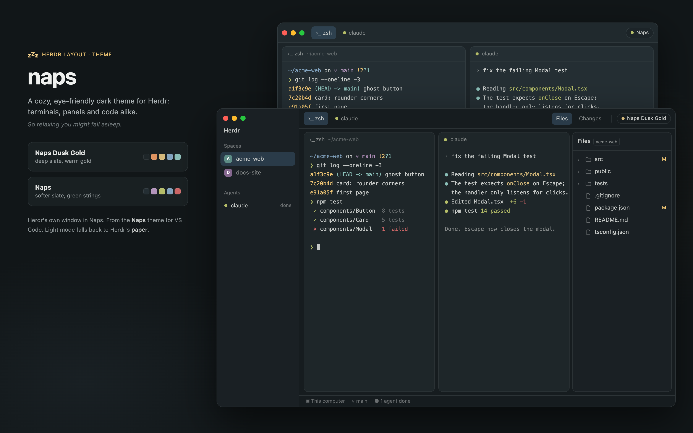

# Naps

Herdr's own window in the Naps themes: Naps Dusk Gold in dark mode, Herdr's `paper` in light
mode, and a light/dark button at the right end of the bottom row. 

## What you see

The shipped `main` layout with the root `"theme": {"light": "paper", "dark":
"naps-dusk-gold"}` (Naps has no light variant yet), and its 28px `status` block turned into a
`status-row`: `workspace-status` (weight 1), then the `naps` block (36px). Colours (Naps Dusk
Gold): terminal background `#1e2629`, sidebars `#1a2024`, canvas `#161c1f`, popovers `#12171a`,
accent `#81a2be`, primary button `#4b7293`.

### The button (`mods/naps`)

- `chrome` background, a 1px `border` line on top like `workspace-status` beside it.
- 24px square, centred, 6px corners, `hover` on hover. The icon (14px, `dim`, `foreground` on
  hover) is what a click switches to: a sun in dark mode, a moon in light. Tooltip "Light mode
  (⌥⌘L)" / "Dark mode (⌥⌘L)".

## How it behaves

As Herdr's `main`. Both `naps` and `naps-dusk-gold` are listed in Settings → Look; the theme
picker overrides the layout's theme (a light theme sets the light half, a dark one the dark half),
and Settings → Appearance (System / Light / Dark) picks the half.

- A click on the button or ⌥⌘L flips light ↔ dark by writing `appearance` to settings.json
  (live; Herdr has no command for it), from what shows now (`settings().dark`), so it works when
  Appearance follows the system too. A second flip within 0.5 s is ignored: a held key repeats,
  and `settings().dark` changes only once Herdr has read the file.
- ⌥⌘L is bound under `layout:naps` (`keys.json`), so it holds only while this layout shows and
  wins over a `global` binding of the same key. A mod key reaches only copies on screen; the
  button is always on screen here, so the key always works.

## Built from

- `layouts/naps.json`: a copy of the shipped `main.json` (Herdr 0.1.15) with the theme and the
  status row above.
- `themes/naps.json`, `themes/naps-dusk-gold.json`: generated by `scripts/import-cursor.mjs` from
  the Naps theme for VS Code (editor, sidebar, list and terminal colours; translucent ones
  flattened).
- `mods/naps/`: `main.js` (the button and the command), `lib/appearance.js` (pure, `node --test`),
  `lib/name.js`, `icons/sun.svg`, `icons/moon.svg` (Lucide, ISC; licence beside them). Tests in
  `naps/tests/`.
- `keys.json`: `layout:naps` › `cmd-alt-l` → `naps.toggle-appearance`.

## Install

1. Copy `themes/*.json` to `~/.config/herdr-app/themes/`, `layouts/naps.json` to `layouts/` and
   `mods/naps/` to `mods/`.
2. Merge `keys.json` into `~/.config/herdr-app/keys.json` (add the `layout:naps` section).
3. `herdr-app do layout.switch '{"name":"naps"}'`.
4. With [code-explorer](../code-explorer/) wanted too: install it after this; its recipe points
   this layout's Files block at it. [agent-usage](../agent-usage/) goes into the status row,
   between `status` and `naps`. [spaces-tree](../spaces-tree/) replaces the layout's `sidebar-lists`
   column (the `spaces` and `agents` blocks) with one block.

## Watch out

The layout is a copy, so Herdr updates to `main` don't reach it.

## Done when

`herdr-app status` shows layout `naps` with no errors; the terminal background is `#1e2629`; the
sun shows at the bottom right and ⌥⌘L turns the window light.
