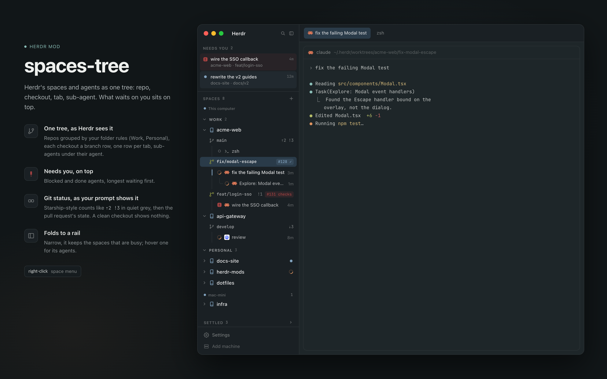

# spaces-tree

Herdr's sidebar as one tree. What waits on you is on top (blocked and done agents, longest wait
first), then every repo as a heading with one row per checkout under it (the main folder and
each worktree open as a space, named by its branch), each space's agents, and their sub-agents.
A space that isn't in git is a folder with its tabs under it. Machine
groups appear when you have a remote machine. Everything the shipped spaces and agents lists do
still works: drag to reorder, right-click menu, pinning, folding, machines, a rail when the
sidebar is narrow.

Colour is kept for agent state and pull-request state. At the right of each checkout row,
before its PR tag, git's state is written with your terminal's symbols and their counts (`=1 $2 ✘2 »1 !9 +3 ?3 ⇡1 ⇣3`, as in
starship and the Claude status line), in one dim colour.



## Install

Copy `mods/spaces-tree/` into `~/.config/herdr-app/mods/`. With the [naps](../naps/) layout, or
in a layout of yours (a clone of `main`: `herdr-app do layout.clone '{"name":"main","as":"my-main"}'`),
replace the `sidebar-lists` column (the `spaces` and `agents` blocks) with this block:

```json
{ "id": "sidebar-lists", "type": "block", "content": { "mod": "spaces-tree" } }
```

No key is added. It replaces the shipped spaces and agents lists, and gives new spaces their
colour in their place.

## Groups

Repos can sit under group headers, decided only by where they are on disk. Write the rules in
`~/.config/herdr-app/spaces-tree.json`:

```json
{
  "groups": [
    { "name": "Work", "path": "~/code/work" },
    { "name": "Personal", "path": "~/code/personal" }
  ]
}
```

A repo (with its worktrees) goes to the group whose path is the longest prefix of its main
folder; anything else goes to `Other`, last. Groups show in the file's order, and only when a
machine has two or more of them. A click on a header folds it, showing what its agents are
doing at its right. Drag a header to put the groups in your own order (per machine; `Other`
stays last). That order is kept by the mod, not in the file, and Herdr's space order follows it;
a group you add later goes after the ones you placed. The file is read again every few seconds;
without it, or with bad JSON, there are no groups. On a remote machine `~` isn't known, so only
absolute paths match there.

Right-click the `SPACES` header or a group header and choose **Edit groups…** to open the file in
your text editor. When there is no file yet it is created first as `{ "groups": [] }`, which
changes nothing until you add a rule.

## What it runs

- `git`, per open space: `rev-parse` and `symbolic-ref` for the repo and branch, then the same
  read as the Claude status line, `git --no-optional-locks status --porcelain=v2 --branch`, with
  `--show-stash` for the stash count and `--untracked-files=all` so untracked files are counted
  one by one as starship does (no index rewrite; slower on a checkout with many untracked
  files), for the git counts.
- `gh pr view`, at most once a minute per checkout, only while the window is in front and the machine isn't folded (a branch change asks at once), for the pull-request tag (`#12 ✓`,
  `checks`, `review`, `merged`). Optional: without `gh`, or not signed in, there is no tag and
  nothing else changes. ⌘-click a tag to open the PR.
- `hc machine ls --json` every 15 seconds, always (as the shipped Spaces list does), to know the remote machines.

It writes only Herdr's space colours and its own saved state (folds, group order, how long each
agent has been in its state). It reads `~/.config/herdr-app/spaces-tree.json` (the group rules);
it writes it only when you choose Edit groups and it doesn't exist yet (`{ "groups": [] }`), and
then opens it with your system's opener (`open -t`, `xdg-open` or `start`).

## Credits

Glyphs are Herdr's own, except the repo book, drawn for this package.

[RECIPE.md](RECIPE.md) is the brief to build it again.
