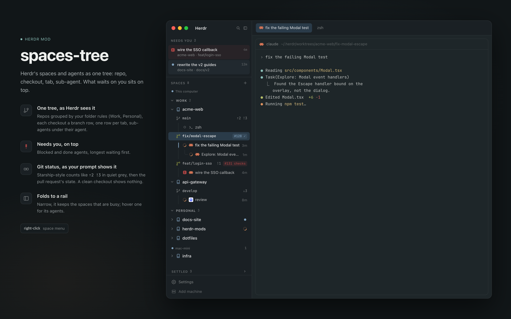

# spaces-tree

The sidebar's two lists, spaces and agents, as one: what waits on you on top, then one tree of
machine, repo group (when rules make two or more), repo, checkout (one row per space), agent and sub-agent. Nothing the shipped `spaces` and `agents` mods do
is lost. This is the brief; the files beside it are one build.


## What you see

All colours come from `theme()` names, so it follows any theme (Naps Dusk Gold, `paper`, others).
Colour means agent state and PR state only; git's symbols and counts are `muted`.

### Needs you (top, fixed, does not scroll)

- Header `NEEDS YOU n` (10px caps, `dim`), nothing at its right: `agent.next` (⌘]) walks every
  agent, not just these, so the band doesn't name it.
- One row per agent that is `blocked` or `done` (a sub-agent's `error` counts as blocked, its
  `done` as idle), the longest wait first. A `done` agent in the focused pane stays out (the
  person is already looking; Herdr turns it idle on their next move); a focused `blocked` one stays. Status mark, then two lines: the cleaned title (no
  spinner or glyph), and in `muted` `repo · branch` from the agent's space's git (a space not
  in git: its name); the time waiting at the right (`<1m`, `Nm`,
  `Nh`, `Nd`). Background `blocked` at about 10% or `done` at about 7% over `chrome`.
- A title that says nothing reads the program's name instead.
- Nobody waiting: no band, no header, no rule. A click is `pane.focus {pane}` (a sub-agent
  without a pane: `terminal.peek`). Band rows are shortcuts: the agent is also in its place in the
  tree, and a band row is never lit.
- Rows come and go, never pop: a new row grows in from height 0 with opacity 0 → 1, a row
  leaving (seen, no longer waiting) fades out and collapses to 0, both over 180ms ease-out by
  native `transition("height" | "opacity")`; a leaving row keeps its last content and takes no
  clicks, then is dropped. The first row brings the whole section (header, rule) in the same
  way and the last one takes it away, so the tree below slides instead of jumping. A reorder
  (longest wait first) just jumps. Each row is a fixed 46px (two lines, 5px above and below: a box
  shorter than the row would clip its rounded corners) with 2px under it, in a box of that height
  (`band-<address>`); nothing grows in at start. `lib/presence.js` keeps the books (entering,
  shown, leaving); an entering row is drawn once at 0 and again ~16ms later at full height (a
  one-shot `cx.timer.after`, as a transition only animates a later change), and one more
  one-shot drops a finished leave.

### PINNED

A group between the band and the tree with the pinned agents (`terminal.pin`), same rows as in
the tree, each with a second line naming where it is (`repo · branch`, else the space's name; 11.5px
`muted`, as the band's), the row 40px. A pinned agent leaves the tree and shows only here (and in the band while it waits).
Hovering an agent row swaps its time for the pin button, as shipped.
Rows and the section grow in and collapse as the band's (same `lib/presence.js`, same 180ms),
each in a box of its own height (40px with a second line, else 28px).

### Tree (scrolls)

- Header `SPACES n`; at its right `+` (`space.new`). A right-click on it opens the groups menu
  (below).
- "● This computer" (10px, weight 500, `dim`, 6px `done` dot; a remote header's dot is `done` when connected, else `dim`) above this computer's spaces always;
  with a remote machine configured a click folds them and, on hover, a `+` makes a space here. A remote machine's group header has all
  the shipped spaces mod does there: state word, Connect, login guidance with Copy, the warning that agents stop
  when you disconnect (opens the `machine-add` dialog), `+` per machine, fold, "Loading…",
  an empty machine's "New space there".
- **Repo group header** (only with rules, below): between the machine header and its repo
  and folder headings, 26px, 6px above, 6px radius, on the headings' grid (padding 6, gap 6):
  Herdr's `chevron-down` / `chevron-right` (12px, `dim`) in the 12px chevron slot, so it lines up
  with the repo chevrons, then the group's name at the repo glyph's column in 10px caps
  (`foreground` at 65% (`a6`), a grey a step above `muted`: Herdr's built-in Geist draws every weight as regular, so the label stands out by colour, not weight; gpui has no letter spacing, so a hair space, U+200A, between letters stands in for the mock's .08em tracking), the number of headings in it in
  mono 10px `dim`. Hover `hover`; a click folds it; a drag moves it among its machine's group
  headers (the dragged one at 50% opacity, a 2px `accent` drop line on the target's top or
  bottom edge, as a heading drag); `Other` doesn't drag and takes no drop, so it stays last. A
  right-click opens the groups menu. Folded: its headings go, and at its right
  the distinct status marks of what was under it (as a folded heading reads them, from statuses
  and folded marks), most urgent first (blocked, done, working; idle shows nothing), at most 3. The rows under
  it keep their columns: no indent. A machine with only one group to show (Other included) shows
  no header: the tree is as without rules. An open header with nothing drawn under it (its
  spaces still waiting for their git) is not drawn.
- **Repo heading** (Orca-style: a repo is only a heading; every space is a checkout row under
  it), 28px, 6px radius: 12px fold chevron (`dim`), the 14px repo book glyph in `accent`, the
  repo's name (13px, weight 500). No tags. Hover: the repo's folder (the common dir's parent). Its key is the git repo's identity (`Git.repo`, which
  includes the machine): every space of that repo sits under it, wherever it is in Herdr's
  order. A click folds it (as the chevron); a right-click opens the space menu of its main
  checkout (else its first space). Folded: the most urgent status mark of all its checkouts
  (blocked, done, working; all idle: none) at the row's right end, one column whatever the
  name's length, no tags. `space.colors` is still assigned (Herdr's menus) and drawn only
  on the rail's tiles.
- **Checkout row**: one per space of the repo: first the main checkouts (not linked), then the
  linked worktrees, each in `spaces()` order. A worktree whose main checkout isn't open as a
  space still sits under its heading. 26px: the chevron's slot (hidden), a 14px glyph (no colour change when shown): Herdr's `branch`
  in `muted` on the main checkout (`kind` `main`), Herdr's `git-branch` (the glyph its space menu
  gives New / Open worktree) in the theme's green (`ansi2`) on a linked worktree (`kind` `worktree`); then the branch in 11px mono
  `foreground` at 80% (`cc`; the shown space's row full `foreground`, weight 500; `(detached)` when so), then the tags at the right. No home mark. The shown space's row is `selected`, no bar:
  the one `accent` bar marks the lit row under it (what has focus), so the two don't double up. Hover: `<space name> · <folder>` (`~/…`), so two spaces on one checkout,
  or a renamed one, tell apart. Click
  `space.select`; right-click its space menu.
- **Folder heading**: a space not in git, or whose git is still unknown after the 1.5s wait:
  a heading-style row with Herdr's `folder` glyph (`accent`) and the space's name, its tab and
  agent rows right under it, no checkout row. It is the space: click selects, right-click is its
  menu, shown it is `selected` with the accent bar; it folds by itself (`space:<id>`).
- Columns, px from the sidebar's left edge (rows sit 6px in): a child starts at its parent's
  name column. Heading: chevron 12–24, glyph 30–44, name from 50. Checkout: glyph 30–44 (the
  heading's glyph column), name from 50. Agent / tab row: status mark 50–64, program icon 70–84,
  title from 90. Sub-agent row: 20 further per level (mark 70–84 in its parent's icon column,
  icon 90–104, title from 110), with an elbow (1px `border`, radius 4) from its parent's mark
  centre (x≈57) down to its middle and right to x≈66. Every agent, tab and sub row under a
  checkout or folder heading carries a 1px `border` guide at x 37 (the glyph's centre); the
  lit row's segment is a short 2px `accent` bar (16px: 6px clear of the row's top and bottom, rounded). PINNED and the rail's card draw flat (mark at 20, no
  guide). The constants are in one place at the top of `host/rows.js`.
- **Agent row**: status mark, program icon (tinted when `tint`), title (`foreground` at 80%, a step under its heading, idle included; lit: full `foreground`, weight 500), time in the current state
  (on hover the pin button). A named tab (`TabInfo.named`) with exactly one agent row shows the tab's name as that row's title, the agent's own cleaned title in its tooltip; with several agents, or unnamed, each keeps its own title (band and PINNED rows always do). In tab and pane order, never by urgency, so rows don't move.
- **Tab row**: a tab with no agent and not settled: one row per tab, the idle ring (so the status
  column lines up), its lead pane's program icon and title (`foreground` at 80%; lit: full `foreground`, weight 500), no time. The title: the tab's name when someone named it, else the pane's live title when it says something (not the terminal's id, the program's name, a path or `user@host`), else only the program's name (`zsh`) with its folder (`~/acme-web`) in the row's tooltip. Click: `space.select` + `tab.select`.
- **Sub-agent row**: same parts: its title is the terminal's own title (cleaned; else its name,
  template, program), the time in its current state at the right. Click: `pane.focus {terminal}`
  if it is kept, else `terminal.peek`. An agent with sub-agents folds them; folded, the count is
  coloured by the most urgent one.
- Folds are stored per heading (`repo:<Git.repo>`, or `space:<id>` for a folder heading; a
  group header's `group:[machine, name]`) with its machine; a fold is dropped only when its machine's layout is ready, every space there has
  a known git, and no listed space has that heading, so a machine still loading keeps its folds.
  Folds stored by space id before headings move to the heading once the space's git is known,
  only a main checkout's or a non-git space's (an old worktree fold is dropped, it never folded
  the whole repo); one whose space is gone goes when its machine is ready. A group fold stays
  while some heading there falls in that group (header shown or not), and while the rules
  aren't read or aren't valid JSON (an edit half done keeps the folds).
- Reveal the focused place when something happens there (`lib/reveal.js`): a pass whose
  `moment` differs from the last one's (the focused pane or terminal; the lit agent's status,
  as when a prompt is sent or it finishes; the shown tab's `changed_at`; a tab or pane opened or
  closed in the shown space; the rows above the target, as when its git comes in; the first pass
  counts) opens the folded machine, group, repo or folder heading and parent agents above the
  target, stored as a chevron click would; siblings stay folded, and the list scrolls to it as
  for a new shown space. The target is the lit row as if nothing were folded, else the shown
  space's row. Between events nothing is forced: a fold made by hand stays folded until the next
  one. A pinned agent opens nothing; nor does a pass within 1s of a press in the list (a folded
  folder heading's click selects its space).

### Repo groups (rules)

- Only folder rules decide which group a repo is in: no drag between groups, no tags, no
  colours. The
  rules are the person's, in `~/.config/herdr-app/spaces-tree.json` (`appHome()`), outside the
  mod's folder (an install replaces that), one file for the released mod and its `-test` copy:

  ```json
  { "groups": [ { "name": "Work", "path": "~/code/work" }, { "name": "Personal", "path": "~/code/personal" } ] }
  ```

- A heading's folder: a repo heading's own folder (the common dir's parent, the main checkout:
  its worktrees follow it wherever they are), a folder heading's place (its first terminal's
  folder, else where it was made). It goes to the rule whose path is the longest prefix of it,
  by whole segments (`~/Dev/BSG` never takes `~/Dev/BSGx`); trailing slashes don't count.
  `~` is the machine's home: this computer's `home()`; a remote machine's home isn't known, so
  there only absolute rule paths match. Unmatched: `Other`, always last. Groups follow the rules'
  order (a name used twice is one group, where it first appears), unless the person dragged
  their headers; empty groups are not shown.
- **Group order**: dragging a group header onto another of the same machine puts it after that
  one when moving down, before it when moving up (`lib/groups.js` `moveGroup`). The order is the
  mod's own, per machine, in `localStorage` `groups.order` (`[[machine, [name, ...]], ...]`),
  never written to the rules' file. Names in the stored order come first, in that order; groups
  not in it (a new rule) follow in the file's order; a stored name that is no longer a rule is
  ignored, and dropped from storage only once its machine is `ready` and the rules were read and
  valid (as group folds). Herdr's space order follows (`coreOrder` → `keepOrder`'s `space.move`).
- **Groups menu**: a right-click on the `SPACES` header or on any group header opens a popup copy
  of this mod (`props {mode: "menu"}`, Herdr's popup frame, 200px, drawn as the shipped `menu`'s
  items: `popover`, 5px padding, 31px rows, 7px radius, 14px `muted` glyph, 12.8px text) with one
  item, **Edit groups…** (Herdr's `square-pen`); Enter runs it, Esc closes. It opens
  `~/.config/herdr-app/spaces-tree.json` in the system's text editor (`open -t <path>` on macOS,
  `xdg-open <path>` on Linux, `cmd /c start "" <path>` on Windows; the path always its own
  argument), first creating it as `{ "groups": [] }` (`writeTextFile` with `expected` null) when
  it is missing, so nothing changes until the person writes a rule. An existing file is never
  touched. Herdr has no editor mod, so it opens outside Herdr. The 5s re-read picks the edit up.
- The file is read at the start and every 5s (`readTextFile`, off the UI thread), redrawn only
  when its text changed; a failed read keeps the last rules. Missing: no groups. Not the shape
  (bad JSON, no `groups` list): no groups and one console warning per text. Entries without a
  name or path are skipped (`lib/groups.js`).
- With headers on a machine its headings are in group order, and Herdr's space order follows
  (`coreOrder`, in the slots that machine's headings had, so machines stay interleaved). A
  heading drags only onto a heading of its own group; a group header only onto another group
  header. `setAgentOrder` follows the display order
  (folded groups count as open, like folded headings). The band, PINNED, SETTLED and the rail
  ignore groups.
- Lit: the shown space's checkout (or folder) row is `selected` with its accent bar. One row
  is lit (`foreground`, weight 500, its guide segment a 2px `accent` bar, no fill): the agent or
  sub-agent row of the focused terminal (`focused().terminal`, else the agent in
  `focused().pane`); with focus on something else (a shell split beside an agent, a tool), the
  shown tab's tab row, or, when the tab has agents, its first drawn agent row. When that row
  isn't drawn (folded away; the tab's agents all pinned or settled) nothing is lit.
  `focused().agent` is not used (it is the agent an agent block shows, not what has focus).
  Band rows are never lit.
- **Git counts**, at the right end of a checkout row, before the PR tag (on the rail's card,
  at the right of the branch line, before the PR tag); the branch name takes the width left and
  ellipsises. With the person's terminal's symbols in its order (`~/.config/starship.toml`
  `[git_status]`, `~/.claude/statusline-command.sh` `git_status_line`; `lib/gitstatus.js`),
  each followed by its count, space-separated, 11px mono, no chip, all `muted`:
  `=1 $2 ✘2 »1 !9 +3 ?3 ⇡1 ⇣3` (conflicted, stash entries, deleted, renamed, modified, staged,
  untracked, ahead, behind; only the non-zero ones; ahead and behind both when both). A staged
  delete counts as `✘` only and a rename as `»` only (like starship); untracked is the number of
  `? ` lines, one per file (`--untracked-files=all`, as starship counts). Hover: the counts in words ("2 deleted · 9 modified · 3 untracked · 1 ahead"). A
  machine that is away keeps its last counts.
- **Tail**, on checkout rows only (headings carry none): the git counts, then the PR tag at
  the far right, as a chip
  (16px high, 5px side padding, radius 4, 10px mono weight 500) on its tone at 14% (`blocked`
  15%). No branch chip (the row's name is its branch), no ↑↓ or change-count chips (the
  git counts say it). A machine that is away keeps its last tag, dimmed.
- **PR tag** (needs `gh`; optional): `#n ✓` (`done`), `#n checks` when failing (`blocked`),
  `#n review` (`accent`), `#n merged` (`ansi5`); precedence: merged is decided by state first; for an open PR failing, then review (a draft shows review), then ✓.
  `#n merged` shows only while the checkout's HEAD is the merged PR's head commit (`git rev-parse HEAD` runs beside `gh`, compared without case); a long-lived branch with an old merged PR shows no tag. A failed `rev-parse` stores no sha (never an older one), so a merged tag hides until HEAD is read again.
  ⌘-click (Ctrl off macOS) opens the PR; a plain click selects the row.
- **SETTLED n** at the end of the scroll, folded by default (kept in `localStorage`): the tabs
  with `settled: true`, a row `tab name · space`; click: `space.select` + `tab.select`. A settled
  tab with an agent that needs you un-settles itself and returns to the tree.
- Status marks as the shipped agents mod: working a spinner, blocked a `!` box, done a filled
  dot, idle a ring.

### Rail (sidebar narrower than 160px)

- A count tile on top (`blocked` tint, the number of waiting agents; click focuses the first),
  `+` for a new space, then one 32px tile per space that has an agent that isn't idle: the
  space's initial on its `space.colors` colour, the status mark at the corner, the shown space
  selected. The rest fold into a dashed `+N` tile that widens the sidebar
  (`layout.resize {id:"sidebar", px: shared("sidebar.width") ?? 268}`, and `sidebar.collapsed`
  set false, as the shipped toggle does). At the bottom, a 28px row with the shipped agents
  list's `»` (13px, `dim`, `foreground` on hover) that widens it the same way: on macOS the
  traffic lights hide workspace-chrome's toggle on the rail, so this is the way back.
- Hovering a tile opens a 280px card at its right (`HoverCard`, `popover` background): name,
  folder, branch with the tail, then the space's agent rows (clickable). Click the tile:
  `space.select`. The rail is chosen by the width, not by the legacy `sidebar.collapsed` flag.

## How it behaves

These are what the shipped mods do, and each must keep holding.

1. A checkout (or folder) row selects on mouse-up (`space.select`). A drag inside one machine (and, for headings, one repo group)
   reorders with `space.move` (a 2px `accent` drop line), never across machines
   (`lib/order.js` `dropOk` / `dropMoves`): a checkout row drops only on a checkout row of its
   own heading (mains among mains, worktrees among worktrees, so the main stays first); a heading
   (repo or folder) drops only on another heading and moves its whole group, after the target's
   group when moving down, before it when moving up; a repo group header drops only on another
   group header (never `Other`) and its new place is stored, Herdr's order following.
2. A right-click on the `SPACES` header or a group header opens the groups menu (Edit groups…).
   A right-click on a checkout or folder row opens `menu` as a popup (`tab: "space"`,
   `target: {id}`): rename, new / open / remove worktree, close; on a repo heading, the menu of
   its main checkout (else its first space).
3. Herdr's own space order is kept in step with the displayed one by `space.move`: `spaces()`
   order with each repo's spaces together at the position of the repo's first space, the main
   checkout first (`lib/tree.js` `coreOrder`). A move is retried only after the order key
   changes, or a second after every affected machine is `ready`.
4. A new space stays hidden until its git is known or 1.5s pass, so it doesn't jump. A space
   whose repo can't be read is a folder heading without tags.
5. Machines: `hc machine ls --json` every 15s (non-temporary ones) combined with `machines()`;
   reconnect, remove and add flows; `localStorage` `machines.folded` and `machines.reconnecting`.
6. Agents: `pane.focus`, `terminal.peek`, `terminal.pin` (hover pin; the hover is cleared on a
   click), sub-agent fold. `setAgentOrder` gets pinned first, then the tree in display order,
   each address once (the band is not part of it), so `agent.next` / `agent.prev` walk it.
7. Durations: per agent `localStorage` `changed` `{address: {s, at}}`, done counts as idle,
   entries older than 30 days dropped, written only when something changed; the rows re-render
   every 30s.
8. The shown space's row is scrolled into view (`scroll_to_item`, counting every direct child of
   the list, machine headers and notes too), again when the size changes, and not within 1s of
   a press in the list.
9. The rail is shown by width (under 160px).
10. `space.colors`: this mod gives a new space its colour (the least used of the palette, none for
    `~`, gone ids dropped), and writes `shared("space.colors")` only when the set of space ids
    changes, checked every 250ms outside render.

Git, per place, scheduled as the shipped spaces mod: `rev-parse --show-toplevel` and
`--git-common-dir`, then `symbolic-ref -q HEAD` beside the status line's own read plus
`--show-stash --untracked-files=all`: `git --no-optional-locks status --porcelain=v2 --branch
--show-stash --untracked-files=all` (ahead/behind from `# branch.ab`, the stash count from
`# stash N`, and the counts; every untracked file listed, so `?N` counts files as starship
does; 60s timeout). Two git runs per place at a time at most. A
failed or slow status keeps the last state (and never loses the branch). At most 6 places at
once, deduplicated; read again on a new key, a changed place, a pane going from busy
to not busy, a machine turning `ready`, a change in a local repo's common dir (`watchFolder`),
and every 60s while the window is active and the machine isn't folded.

`gh pr view --json number,state,isDraft,url,statusCheckRollup,reviewDecision,headRefOid` per checkout
(cwd, on its machine), at most once a minute and sooner only when the branch changes, at most 2
at a time; answers for another branch are dropped; `gh` missing, signed out, no PR or an
Enterprise remote means no tag and no text, and a failed ask keeps the last good tag.

Edge states: no agent waiting, no band. Repo with no agents: its heading and its checkout rows (with their tab rows). No agents at all, the
tree only. A remote machine away, its group shows the state word and Connect.

## Built from

- Herdr's `spaces()`, `agents()`, `terminals()`, `panes()` (each read once per pass),
  `machines()`, `focused()`, `theme()`, `shared("space.colors")`; `exec` for `git` and `gh`, `hc`
  for machines, `watchFolder`. `gpui-kit` / `gpui-base`: `View`, `div`, `svg`, flex helpers,
  `ScrollHandle`, `HoverCard`. No `setTimeout` (`cx.timer`), no `cx` kept, no `setShared` on a
  render path.
- `lib/` (pure, `node --test`, tests in `spaces-tree/tests/`): `name.js` (the mod's only name),
  `git.js` (parse, place, key), `gitstatus.js` (porcelain v2 → the terminal's symbols with counts), `tree.js` (headings and checkout rows, core order, the lit row,
  lead panes, sub-agents), `band.js` (and the band's repo · branch), `time.js` (clean, age,
  track), `order.js` (agent order, space moves, drops), `colors.js`, `pr.js`, `tail.js`,
  `rail.js`, `presence.js` (band and PINNED rows entering, shown, leaving), `groups.js` (repo group rules: parse, longest-prefix match, order, marks, the dragged group order), `folds.js` (folded headings and groups and their machines, the old space-id folds' move).
- `host/`: `git.js` (the scheduler), `machines.js`, `pr.js`, `rows.js`, `rail.js`, `menu.js` (the
  groups menu and Edit groups: `openOverlay`, `readTextFile`, `writeTextFile`, `exec`, `notify`).
- Glyphs: Herdr's own, from the shipped `workspace-chrome` mod
  (`svg("mods/workspace-chrome/<name>.svg")`, as the shipped spaces mod draws them): `branch`
  (main checkout rows and the rail card), `git-branch` (linked worktree rows), `folder`, `chevron-down` / `chevron-right` (folds),
  `pin`, `pin-off`, `plus`, `server`, `spinner`, `square-pen` (Edit groups…). `icons/` keeps only what Herdr lacks: `repo.svg`
  (the repo book; drawn for this package, under this repository's licence).
- Ported from the shipped `spaces` and `agents` mods in `~/.config/herdr-app/mods/`; those two
  stay untouched.

## Install

1. Copy `mods/spaces-tree/` into `~/.config/herdr-app/mods/`.
2. In a layout that has a `sidebar` column (the [naps](../naps/) layout, or a clone of `main`:
   `herdr-app do layout.clone '{"name":"main","as":"my-main"}'`), replace its `sidebar-lists`
   column (the `spaces` and `agents` blocks) with this one block. `brand` and `sidebar-footer`
   stay `workspace-chrome`:

   ```json
   { "id": "sidebar-lists", "type": "block", "content": { "mod": "spaces-tree" } }
   ```

3. `herdr-app do layout.switch '{"name":"<your layout>"}'`.

No key is added: `agent.next` keeps whatever it is bound to. Optional: `gh`, signed in, for the PR
tags.

## Watch out

- Its glyphs come from the shipped `workspace-chrome` mod (`mods/workspace-chrome/…`), which
  Herdr always has; without it they would be blank.
- It replaces two shipped mods in the layout, `spaces` and `agents`, and does what both did.
  Don't run it beside either of them in one layout: they would both write `space.colors` and
  both keep the order.
- It takes over `space.colors`: a new space gets its colour from this mod while it is in the
  layout.
- PR tags need `gh` (optional); without it nothing else changes.
- The layout is a copy, so Herdr updates to `main` don't reach it.
- No "current step" line, no search or filter: by design.
- Untracked files are counted one by one (`--untracked-files=all`, so `?N` matches starship):
  git walks into every untracked folder, which is slower on a checkout with many untracked
  files (a big build or dependency folder that isn't ignored). Ignored folders are skipped by
  git. It runs in the background with a 60s limit, and a slow or failed read keeps the last
  counts.

## Done when

`npm test` passes. `npm run sync -- spaces-tree` passes `herdr-app check`, and `herdr-app status`
shows `"errors": []` on `herdr-mods-test`. `herdr-app shot` shows the band, tree, checkout rows and
agents in dark and in light. Every item under "How it behaves" holds, and `preview.png` is taken
on a sample folder, never on real repositories.
